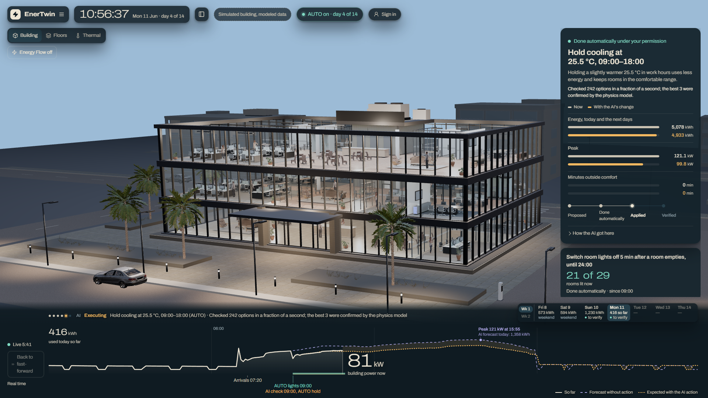
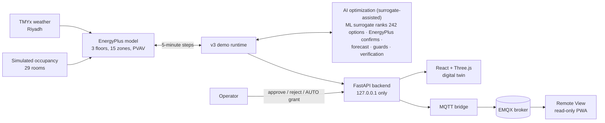
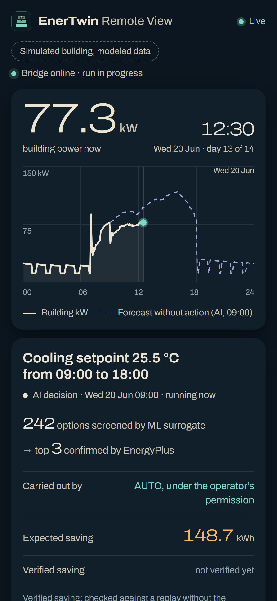
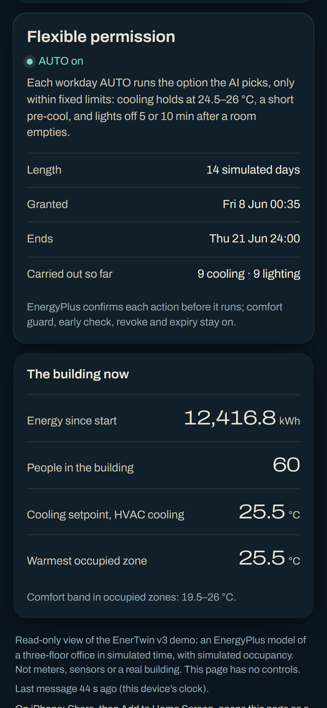
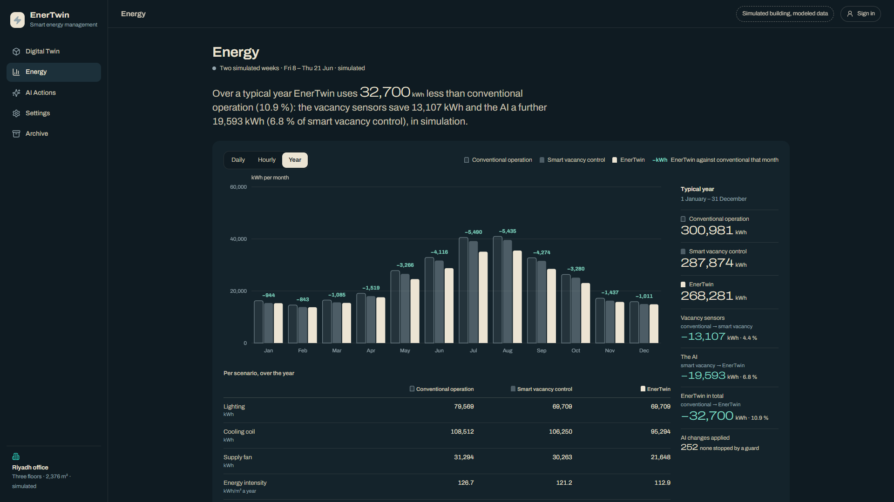
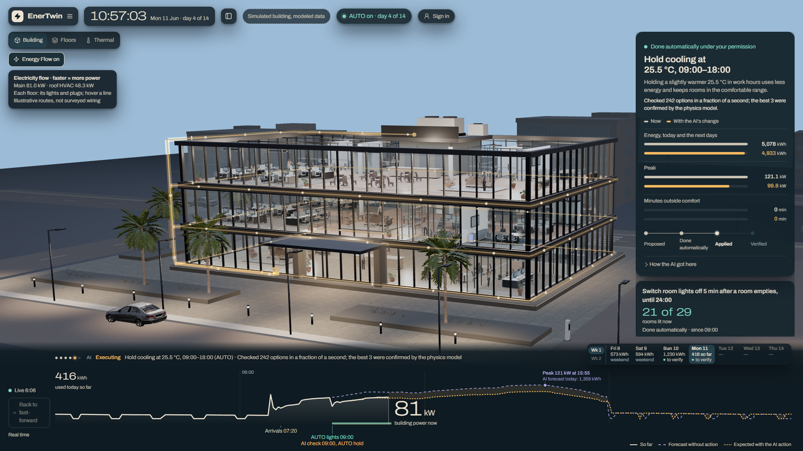
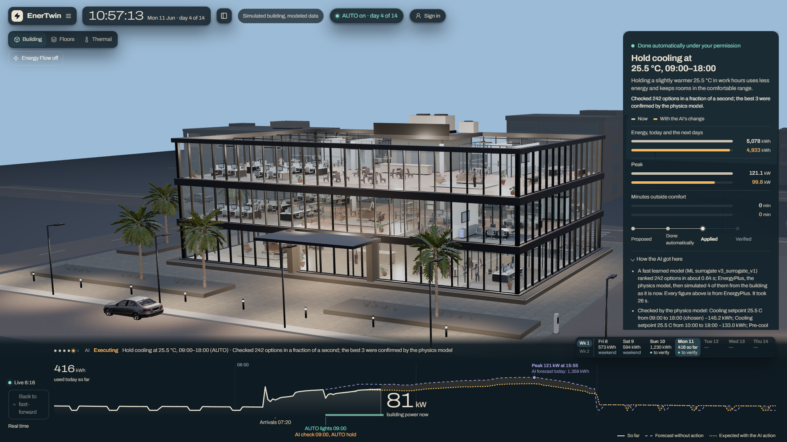

# EnerTwin: an AI energy manager for a simulated office building

EnerTwin runs a three-floor office in Riyadh as an EnergyPlus co-simulation, five minutes at a time, shown as a live 3D twin.
Its core is **AI optimization (surrogate-assisted)**: each workday morning an ML surrogate ranks 242 candidate cooling and
lighting strategies (about 0.11 ms each), EnergyPlus confirms the best, and the controller executes the chosen one with an
operator's approval or under a time-limited AUTO permission; every executed action is then verified against a no-action replay.

> **Everything here is simulated.** No meter, sensor or real building is involved, and the building model is not
> calibrated to a real building. Read the [limitations](#honest-limitations) before quoting any number.

<!-- GIF placeholder: a 20-30 s screen recording of one simulated workday (forecast, suggestion, approval, verification).
     Record it, save it as docs/images/enertwin-day.gif and replace this comment with:
      -->

## Architecture

The ML surrogate only screens candidates. It never approves, executes or verifies anything: every executed action is
confirmed by EnergyPlus first, checked again before it runs, watched by a live comfort guard and verified afterwards
against an independent no-action replay.

## Results (simulated)

### A full typical year, three ways of running the same building

The whole TMYx year (1 January to 31 December) on the same model, weather, people, plugs and HVAC schedule. Details:
[docs/v3_year.md](docs/v3_year.md).

| | Conventional operation | Smart vacancy control | EnerTwin (with the AI) |
|---|---:|---:|---:|
| Lighting | on 08:00–18:00 on workdays, whoever is in | off 15 min after a room empties | as vacancy control |
| Cooling | the standard schedule | the standard schedule | the AI's daily holds |
| Electricity, kWh/yr | 300,981 | 287,874 | **268,281** |
| Energy intensity, kWh/m²·yr (2,376 m²) | 126.7 | 121.2 | **112.9** |
| Highest peak, kW | 151.1 | 149.0 | **131.1** |
| Occupied zone-hours outside 19.5–26 °C | 0 | 0 | **0** |

- **About 11 % less electricity than conventional operation** (−32,700 kWh/yr): vacancy sensors −4.4 %, then the AI a
  further **−6.8 %** (−19,593 kWh/yr, all on the cooling side: coil and supply fan).
- **A 13 % lower annual peak** than conventional operation (131.1 against 151.1 kW), with no occupied hour outside the
  comfort band in any scenario.
- The AI's share follows the cooling load: 0.4–1.2 % in December–March, 9–10 % in June–September.

**Most of what the AI did is a simple rule, and that is the point.** 242 of its 252 cooling holds over the year were
the fixed rule "hold 25.5 °C from 09:00 to 18:00". A building operator could set that rule by hand, but EnerTwin
*found* it from the physics model without being told, *verified* every single application against a replay without
it, skipped it where it would not help, and ran it under guards that stop it on their own when a room gets warm, a
forecast is wrong or a verification shows a loss. The other ten were 26.0 °C holds, later starts, one pre-cool and one
earlier stop.

### The validated fortnight (8–21 June)

Each action verified against an independent no-action EnergyPlus replay over its own horizon, rebound included. No
action over the fortnight: 15,678.3 kWh. Details: [docs/v3_results.md](docs/v3_results.md).

| Run | Optimizer | Approvals | Verified saving | Used |
|---|---|---|---:|---:|
| Manual | EnergyPlus detection list (4–6 candidates) | 10 manual | −1,072.9 kWh | 14,627.1 kWh |
| Exact-hold AUTO | detection list | 0 (one grant) | −1,138.8 kWh | 14,556.2 kWh |
| Surrogate, manual | ML-screened grid, EnergyPlus confirms | 10 manual | −1,565.7 kWh | 14,156.9 kWh |
| **Envelope AUTO** | ML-screened grid, EnergyPlus confirms | **0** (one grant) | **−1,629.1 kWh (10.4 %)** | **14,089.2 kWh** |

The envelope AUTO run reproduces command for command on the current code.

### Other seasons

The all-season surrogate (v2 with the owner options, trained on all twelve months with the test fortnights locked
out) on four fortnights, against the fixed 25.5 °C rule; kWh used. Details: [docs/v3_allseason.md](docs/v3_allseason.md).

| Fortnight | No action | AI, manual | Fixed rule | AI, Flexible AUTO | Rule + lighting delay |
|---|---:|---:|---:|---:|---:|
| 14–27 December (untouched test) | 6,702.4 | 6,653.0 (= rule) | 6,653.0 | 6,665.3 | 6,603.9 |
| 2–15 February (untouched test) | 6,862.2 | 6,850.9 | 6,849.9 | 6,806.2 | 6,805.3 |
| 2–15 March | 7,116.2 | 6,996.5 (= rule) | 6,996.5 | 6,945.8 (= rule + lighting) | 6,945.8 |
| 8–21 June (validated) | 15,678.3 | 14,156.9 (= rule) | 14,156.9 | 14,089.2 (= rule + lighting) | 14,089.2 |

In cooler seasons there is little cooling to save, so the AI's savings are small and it mostly chooses the rule. "Never
worse than the rule" is close but not met exactly: the manual AI trails by 1.0 kWh in February, and in December an
early-read guard suspended AUTO on a day warmer than forecast (61.4 kWh behind rule + lighting); guards stop AUTO
rather than let it run on a doubtful day.

## Features

- **AI optimization (surrogate-assisted).** At the 09:00 decision of a workday an ML surrogate ranks 242 candidate
  strategies (108 cooling holds, 132 pre-cool variants, 2 lighting delays) in about 0.11 ms each (benchmark,
  [docs/v3_surrogate.md](docs/v3_surrogate.md)); EnergyPlus then simulates the best few from the building's current
  state, and the controller executes the chosen one after an operator's approval or under AUTO. The surrogate only
  ranks: it never approves, executes or verifies, and outside its training range a fixed candidate list replaces it.
- **Same-day forecast.** Each morning at 09:00 EnergyPlus forecasts the rest of the day from the building's current
  state, the expected occupancy and the previous day's weather: the day's total kWh and its peak (kW and time), drawn on
  the day chart.
- **Verified savings.** Every executed action is measured against an independent no-action EnergyPlus replay over its
  own horizon, rebound included; a failed verification suspends AUTO until an operator acts.
- **Occupancy-based lighting.** The lights of each of the 29 rooms follow its simulated occupants and switch off 15 min
  after the room empties; the AI can shorten that delay to 5 or 10 min.
- **Live digital twin.** The EnergyPlus building in 3D with its rooms, people and lights, Building, Floors and Thermal
  views, a day chart with the AI's forecast at its peak, and a clock that follows the simulation.
- **Period picker.** The default is the validated June fortnight; visitors can also run any fortnight of the year.
- **Year view.** The full-year experiment month by month in the three scenarios, with the savings.
- **Energy Flow.** Electricity along the building's edges, each floor's line at its own modeled power.
- **AUTO with guards.** Time-limited, owner-scoped permissions: EnergyPlus confirmation and pre-execution checks for
  every action, a live comfort guard, an early read, suspension after a failed verification (never resumes by itself),
  revoke, expiry, an audit trail, exactly-once execution and exact replay.
- **Remote View.** A read-only phone page fed over MQTT (EMQX), with no controls.

  
  
   <em>Remote View: read-only live monitoring from any phone over MQTT</em>

| Year view | Energy Flow |
|---|---|
|  |  |

## Honest limitations

- **Simulated, not measured.** Every number comes from an EnergyPlus model with simulated occupancy.
- **Uncalibrated.** The model's 113–127 kWh/m²·yr is well below the 200–360 kWh/m²·yr reported for Gulf offices, so its
  cooling share is probably under-represented and absolute savings would differ in a real building.
- **Typical weather.** TMYx joins typical months from different years (2011–2025); it is not any actual year.
- **Surrogate range.** The ML surrogate is only trusted inside the range it was trained on; outside it, it falls back
  to a fixed candidate list. Most days of the year were in its training periods, so the year study is an energy
  estimate, not an accuracy test (the locked test fortnights are that).
- **Comfort by air temperature only.** The guards and the comfort band use zone air temperature, not operative
  temperature, humidity or PMV.
- **A chunked year.** The year runs as 28 consecutive segments with a 14-day warm-up each, because the runtime replays
  every run from its first day; effects across a segment boundary are lost (−0.09 % against one continuous run).

## Source code

Source code is private; available for review on request.

## Tech stack

EnergyPlus 26.2 (Python API, 5-minute co-simulation) · Python 3.13, FastAPI, numpy, scikit-learn (gradient-boosted
surrogate) · React, TypeScript, Vite, Three.js · MQTT (paho-mqtt, EMQX Serverless) · unittest, Vitest, GitHub Actions.

## Documentation

[docs/v3_year.md](docs/v3_year.md) (full year) · [docs/v3_results.md](docs/v3_results.md) (validated results) ·
[docs/v3_allseason.md](docs/v3_allseason.md) (seasons) · [docs/v3_surrogate.md](docs/v3_surrogate.md) (surrogate and
envelope) · [CREDITS.md](CREDITS.md) (third-party assets).

## License

Copyright (c) 2026 the EnerTwin author. All rights reserved. No permission is granted to copy, modify, distribute or
use this code ([LICENSE](LICENSE)). Third-party models, the Archivo font and other assets keep their own licences:
see [CREDITS.md](CREDITS.md).
